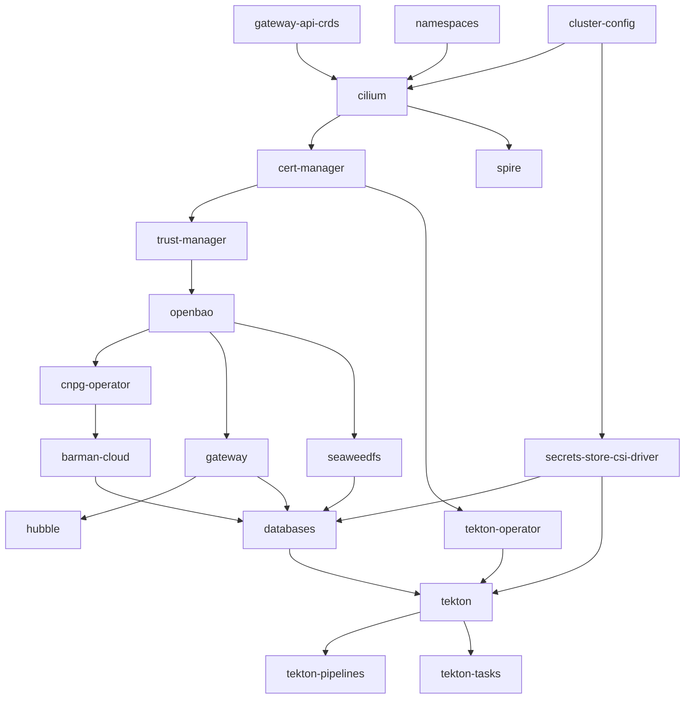

# Installation

This guide installs and configures a local single-node Kubernetes cluster tailored for data science workloads. [Verification](VERIFICATION.md) checks the result once Flux has reconciled it.

The process uses Ansible to provision k3s, Cilium eBPF networking, cert-manager and trust-manager, in-cluster OpenBao secrets management, OpenTofu infrastructure configurations, SPIRE workload identity, and the Flux GitOps controllers, in that order. Once Ansible finishes, Flux takes over GitOps management of the cluster.

Once host-side prerequisites are met, running `just bootstrap` orchestrates the entire cluster lifecycle and reconciles all platform services declaratively.

## Table of Contents

* [Requirements](#requirements)
  * [Host Tooling](#host-tooling)
  * [GitHub Authentication](#github-authentication)
  * [Host Firewall Configuration](#host-firewall-configuration)
  * [Clean Host State (if reinstalling)](#clean-host-state-if-reinstalling)
  * [Data Migration (if restoring an existing database)](#data-migration-if-restoring-an-existing-database)
* [Cluster Bootstrap](#cluster-bootstrap)
  * [Step 1: Clone Repository](#step-1-clone-repository)
  * [Step 2: Execute Ansible Bootstrap](#step-2-execute-ansible-bootstrap)
  * [Step 3: Secure OpenBao Credentials & Unseal Keys](#step-3-secure-openbao-credentials--unseal-keys)
* [Flux Dependency Graph](#flux-dependency-graph)

---

## Requirements

### Host Tooling

`just preflight` checks for each tool below and prints its install command on Debian and Fedora when it is missing. A missing fzf or Tekton CLI is a warning, and the GitHub CLI is checked only when no GitHub App is configured.

#### Flux CLI

Install the version the committed `clusters/local/flux-system/gotk-components.yaml` pins:

```bash
curl -s https://fluxcd.io/install.sh | sudo FLUX_VERSION=2.10.0 bash
flux version --client
```

#### fzf

Used by `just fuzzypods`.

* **Ubuntu / Debian**:

  ```bash
  sudo apt update && sudo apt install -y fzf
  ```

* **Fedora / RHEL / Red Hat**:

  ```bash
  sudo dnf install -y fzf
  ```

#### Git

`just setup` initializes a repository in a source download that has none, and the GitHub CLI fallback reads the repository's `origin` URL.

* **Ubuntu / Debian**:

  ```bash
  sudo apt update && sudo apt install -y git
  ```

* **Fedora / RHEL / Red Hat**:

  ```bash
  sudo dnf install -y git
  ```

#### GitHub CLI (`gh`)

* **Ubuntu / Debian**:

  ```bash
  curl -fsSL https://cli.github.com/packages/githubcli-archive-keyring.gpg | sudo tee /usr/share/keyrings/githubcli-archive-keyring.gpg > /dev/null
  echo "deb [arch=$(dpkg --print-architecture) signed-by=/usr/share/keyrings/githubcli-archive-keyring.gpg] https://cli.github.com/packages stable main" | sudo tee /etc/apt/sources.list.d/github-cli.list > /dev/null
  sudo apt update && sudo apt install -y gh
  ```

* **Fedora / RHEL / Red Hat**:

  ```bash
  sudo dnf install -y 'dnf-command(config-manager)' 2>/dev/null || sudo dnf install -y dnf-plugins-core
  sudo dnf config-manager --add-repo https://cli.github.com/packages/rpm/gh-cli.repo
  sudo dnf install -y gh
  ```

#### GnuPG

`gpg` encrypts the OpenBao unseal keyfile during `just bootstrap` and decrypts it on every `just start`.

* **Ubuntu / Debian**:

  ```bash
  sudo apt update && sudo apt install -y gnupg
  ```

* **Fedora / RHEL / Red Hat**:

  ```bash
  sudo dnf install -y gnupg2
  ```

#### Helm

```bash
curl -fsSL -o get_helm.sh https://raw.githubusercontent.com/helm/helm/main/scripts/get-helm-4
chmod +x get_helm.sh
./get_helm.sh
rm get_helm.sh
helm version
```

#### Just

* **Ubuntu / Debian**:

  ```bash
  sudo apt update && sudo apt install -y just
  ```

* **Fedora / RHEL / Red Hat**:

  ```bash
  sudo dnf install -y just
  ```

#### kubectl

Install the release `KUBECTL_VERSION` pins in `infrastructure/cluster-config/versions.yaml`, which matches `K3S_VERSION` without the `+k3s` suffix:

```bash
KUBECTL_VERSION=v1.37.1
KUBECTL_ARCH=amd64
if [ "$(uname -m)" = "aarch64" ]; then KUBECTL_ARCH=arm64; fi
curl -LO "https://dl.k8s.io/release/${KUBECTL_VERSION}/bin/linux/${KUBECTL_ARCH}/kubectl"
sudo install -m 0755 kubectl /usr/local/bin/kubectl
rm kubectl
kubectl version --client
```

#### kubectl cnpg Plugin

Install the release matching the CNPG operator, which is the `appVersion` of the chart pinned by `CNPG_VERSION` (`helm show chart cloudnative-pg --repo https://cloudnative-pg.github.io/charts --version <CNPG_VERSION>`). `preflight.sh` checks the match.

```bash
CNPG_PLUGIN_VERSION=1.30.1
CNPG_ARCH=x86_64
if [ "$(uname -m)" = "aarch64" ]; then CNPG_ARCH=arm64; fi
CNPG_URL=https://github.com/cloudnative-pg/cloudnative-pg/releases/download/v${CNPG_PLUGIN_VERSION}/kubectl-cnpg_${CNPG_PLUGIN_VERSION}_linux_${CNPG_ARCH}
```

* **Ubuntu / Debian**:

  ```bash
  curl -LO "${CNPG_URL}.deb"
  sudo apt install -y "./kubectl-cnpg_${CNPG_PLUGIN_VERSION}_linux_${CNPG_ARCH}.deb"
  rm "kubectl-cnpg_${CNPG_PLUGIN_VERSION}_linux_${CNPG_ARCH}.deb"
  ```

* **Fedora / RHEL / Red Hat**:

  ```bash
  sudo dnf install -y "${CNPG_URL}.rpm"
  ```

#### OpenTofu

```bash
curl --proto '=https' --tlsv1.2 -fsSL https://get.opentofu.org/install-opentofu.sh -o install-opentofu.sh
chmod +x install-opentofu.sh
sudo ./install-opentofu.sh --install-method standalone --opentofu-version 1.13.1
rm install-opentofu.sh
tofu version
```

#### Tekton CLI (`tkn`)

Lists and follows PipelineRuns, TaskRuns and their logs.

* **Ubuntu / Debian**:

  ```bash
  sudo apt update && sudo apt install -y gnupg
  sudo mkdir -p /etc/apt/keyrings/
  sudo gpg --no-default-keyring --keyring /etc/apt/keyrings/tektoncd.gpg --keyserver keyserver.ubuntu.com --recv-keys 3EFE0E0A2F2F60AA
  echo "deb [signed-by=/etc/apt/keyrings/tektoncd.gpg] http://ppa.launchpad.net/tektoncd/cli/ubuntu eoan main" | sudo tee /etc/apt/sources.list.d/tektoncd-ubuntu-cli.list
  sudo apt update && sudo apt install -y tektoncd-cli
  ```

* **Fedora / RHEL / Red Hat**:

  ```bash
  sudo dnf copr enable -y krouma/kubernetes
  sudo dnf install -y tektoncd-cli
  ```

#### uv

`just bootstrap` runs Ansible through `uv run`, which builds `.venv` from `uv.lock` on first use, Python included.

```bash
curl -LsSf https://astral.sh/uv/install.sh | sh
uv --version
```

### GitHub Authentication

Flux syncs the cluster from a GitHub repository you own. You install each GitHub App in this section on that repository.

#### Your Copy of the Repository

Create your own copy of this repository on GitHub in one of two ways:

* **Fork** it from its GitHub page. A fork is public and can pull later changes from this repository. GitHub turns workflows off in a new fork; turn them on under your fork's **Actions** tab.
* **Push a clone** to a new, empty repository you create. The new repository can be private.

  ```bash
  git clone https://github.com/DragonBishop/data_science_cluster.git
  cd data_science_cluster
  git remote set-url origin https://github.com/<your-account>/<your-repository>.git
  git push -u origin main
  ```

Point Flux at your copy. Set `spec.url` in `clusters/local/flux-system/gotk-sync.yaml` to your copy's HTTPS URL, then commit and push it to `main`:

```yaml
spec:
  url: https://github.com/<your-account>/<your-repository>
```

Flux syncs `main` by default, and `FLUX_GIT_BRANCH` sets another branch at bootstrap.

#### Option 1: GitHub App (Recommended)

A GitHub App is an identity your account owns, separate from your user. It has its own permissions and a private key. A tool signs a request with the private key and receives an installation token, which expires after one hour. Flux's source-controller keeps the private key in a Secret and exchanges it for installation tokens as it needs them.

Your copy's workflows can use three more GitHub Apps: a release-please App you create, Mend's Renovate App and Semgrep's App. Each one is optional, and [Optional GitHub Apps for CI](#optional-github-apps-for-ci) covers them.

Create the Flux App:

1. Open **Settings → Developer settings → GitHub Apps → New GitHub App** (<https://github.com/settings/apps/new>).
2. Enter a **GitHub App name**, which must be unique across GitHub, and set **Homepage URL** to your copy's URL.
3. Under **Webhook**, clear **Active**. Flux polls the repository on an interval.
4. Under **Repository permissions**, set **Contents** to **Read-only**. GitHub adds **Metadata: Read-only** itself.
5. Under **Where can this GitHub App be installed?**, choose **Only on this account**.
6. Select **Create GitHub App**. The App's page shows its **App ID**.
7. Under **Private keys**, select **Generate a private key**. The browser downloads a `.pem` file. Move it outside the repository and run `chmod 600` on it.
8. Select **Install App** in the sidebar, choose your account, then **Only select repositories** and your copy. The installation ID is the number at the end of the page's URL, `https://github.com/settings/installations/<installation-id>`.

Export the three values before running `just preflight` and `just bootstrap`:

```bash
export GITHUB_APP_ID="<your-app-id>"
export GITHUB_APP_INSTALLATION_ID="<your-installation-id>"
export GITHUB_APP_PRIVATE_KEY_PATH="/path/to/your/private-key.pem"
```

`just preflight` reports the App ID it finds. The `flux` role passes the three values to `flux create secret githubapp`, which writes Secret `flux-system` in the `flux-system` namespace.

#### Option 2: GitHub CLI (Fallback)

When `GITHUB_APP_ID` is unset, the `flux` role authenticates Flux with your GitHub CLI token for the repository in your clone's `origin` remote.

1. Authenticate the CLI:

   ```bash
   gh auth login
   ```

2. Verify your status:

   ```bash
   gh auth status
   ```

#### Optional GitHub Apps for CI

Your copy's GitHub Actions workflows use GitHub Apps too. Each workflow reads its App's values from your copy's repository secrets, under **Settings → Secrets and variables → Actions**. `gh secret set` stores a key file's contents directly, for example `gh secret set FLUX_GITHUB_APP_PRIVATE_KEY < /path/to/your/private-key.pem`. To skip an App, disable its workflow under **Actions**, then the workflow's **⋯** menu and **Disable workflow**.

| Workflow | App | Repository permissions | Repository secrets |
| --- | --- | --- | --- |
| `e2e.yml` bootstraps a cluster on a runner | Your Flux App | Contents: Read-only | `FLUX_GITHUB_APP_ID`, `FLUX_GITHUB_APP_INSTALLATION_ID`, `FLUX_GITHUB_APP_PRIVATE_KEY` (the `.pem` contents) |
| `release.yml` opens release-please's release pull requests | A second App you create the same way as the Flux App | Contents: Read and write, Issues: Read and write, Pull requests: Read and write | `RELEASE_PLEASE_APP_CLIENT_ID` (the **Client ID** on the App's page), `RELEASE_PLEASE_APP_PRIVATE_KEY` (the `.pem` contents) |
| `semgrep.yml` runs `semgrep ci` | Semgrep's hosted App, installed when you add your copy at semgrep.dev | Set by Semgrep's onboarding | `SEMGREP_APP_TOKEN` (an API token from semgrep.dev) |

[release-please](https://github.com/googleapis/release-please) runs through [`release-please-action`](https://github.com/googleapis/release-please-action) and opens its release pull requests with its App's installation token. GitHub runs the repository's pull request workflows, such as `lint.yml` and `tests.yml`, on pull requests opened with that token.

Renovate runs as Mend's hosted Renovate App. Install it from <https://github.com/apps/renovate> on your copy. It reads `renovate.json`, and Mend holds the App's private key.

[Semgrep](https://semgrep.dev/docs/) runs as Semgrep's hosted App. Sign in at <https://semgrep.dev> with GitHub and add your copy, which installs the App on it. The `semgrep ci` job in `semgrep.yml` sends its findings to Semgrep with `SEMGREP_APP_TOKEN`.

### Host Firewall Configuration

* [ ] **Host firewall configured for Cilium** — run from a local terminal on the node:

  ```bash
  just setup-firewall
  just preflight
  ```

  On Fedora/RHEL, firewalld must already be active. Setup finds the zone of `LAN_INTERFACE` from cluster-config. It retains named workstation services and explicit ports, opens DNS and the Gateway's 443/5432 listeners, removes the unrestricted `1025-65535` TCP/UDP ranges, and restricts `k8s-containers-to-host` to the trusted Cilium zone. Preflight checks the same restrictions and required forwarding directions.

  Before applying this change to an existing host, inspect its configuration and save a copy:

  ```bash
  sudo firewall-cmd --get-active-zones
  sudo firewall-cmd --list-all-zones
  sudo firewall-cmd --list-all-policies
  sudo cp -a /etc/firewalld /etc/firewalld.before-cluster-hardening
  ```

  Use a new backup path if that copy already exists. Add explicit narrow allowances for any workstation applications that relied on the high-port ranges. Setup writes permanent configuration and reloads firewalld, so retain a local terminal during the change. It preserves Cilium's forwarding policies and trusted interfaces; masquerading stays with Cilium.

  On Ubuntu/Debian, the existing UFW setup permits Cilium interfaces and pod routing and sets `DEFAULT_FORWARD_POLICY=ACCEPT`. The Fedora host-input correction does not change that branch.

  See [Host and LAN Access](NETWORKPOLICY.md#host-and-lan-access) for the rules and [Host Firewall Network Checks](VERIFICATION.md#host-firewall-network-checks) for before/after service checks and LAN validation. If the Fedora change interrupts a required path, restore the saved `/etc/firewalld` directory from the local terminal and run `sudo firewall-cmd --reload`; do not stop the firewall or reopen all ports as the permanent fix.

* [ ] **Reserved IP range excluded from DHCP** — the cluster claims `192.0.2.240`–`192.0.2.250` on your LAN by default (`GATEWAY_IP` through `LAN_LB_POOL_STOP`, plus `COREDNS_LAN_IP`, in `infrastructure/cluster-config/networking.yaml`; `just preflight` checks them). Confirm your router's DHCP pool doesn't hand these out, and that nothing already answers on them:

  ```bash
  ping -c 2 -W 1 192.0.2.240
  ping -c 2 -W 1 192.0.2.242
  ```

  If one answers, `ip neigh show <ip>` prints the MAC address of the device holding it.

### Clean Host State (if reinstalling)

If reinstalling over an existing k3s instance, tear it down first, then reboot before bootstrapping. Cilium's BPF programs stay attached in the kernel after `k3s-uninstall.sh`, and the `k3s` role refuses to install while that state is present:

```bash
just uninstall
sudo reboot
```

### Data Migration (if restoring an existing database)

Have a plain-SQL dump ready to restore once the CNPG cluster exists (see [Verify Database Deployment](VERIFICATION.md#verify-database-deployment)). Make it with `pg_dump --no-owner --no-privileges`, which leaves ownership and grants out of the file:

```bash
kubectl cnpg psql postgres-cluster -n databases --tty=false -- \
  -d data_science -c 'SET ROLE app_readwrite' -f - < /mnt/your/mount/path/data_science_backup.sql
```

`kubectl cnpg psql` runs `psql` in the primary and passes it the file on stdin. `SET ROLE app_readwrite` runs first in the same session, so every restored object belongs to `app_readwrite`.

## Cluster Bootstrap

### Step 1: Clone Repository

Clone your copy of the repository from [GitHub Authentication](#github-authentication):

```bash
git clone https://github.com/<your-account>/<your-repository>.git
cd <your-repository>
```

### Step 2: Execute Ansible Bootstrap

Installs the collections that the `dragonbishop.cluster` `galaxy.yml` depends on, then runs the full setup via the collection's playbook (`dragonbishop.cluster.data_cluster`): k3s, Cilium, cert-manager, trust-manager, OpenBao, `terraform/openbao`, SPIRE and Flux. On a fresh clone, `uv run` first builds `.venv` from `uv.lock`. Idempotent and accepts optional flags (e.g. `--tags`, `--check`, `-v`). When prompted for `BECOME password:`, enter your local user's `sudo` password to allow root-level setup of `/etc/rancher/k3s/` and systemd services.

> [!TIP]
> **Just Recipe (automatically prompts for sudo):**
>
> ```bash
> just bootstrap
> ```

> [!NOTE]
> **Manual Shell Command:**
>
> ```bash
> uv run ansible-galaxy collection install --upgrade -p ansible ansible/ansible_collections/dragonbishop/cluster
> uv run ansible-playbook dragonbishop.cluster.data_cluster --ask-become-pass
> ```

### Step 3: Secure OpenBao Credentials & Unseal Keys

The bootstrap script prompts for a GPG passphrase and an OpenTofu state-encryption passphrase, then prints the in-cluster OpenBao unseal keys and root token.

> [!IMPORTANT]
> Store the generated unseal keys and root token in a secure password manager immediately. Data cannot be recovered if these keys are lost.

Future cluster starts (`just start` / `start-cluster.sh`) unseal OpenBao using the GPG-encrypted keyfile written during bootstrap to `.local/openbao/unseal-keys.gpg`, inside this repo and gitignored. `git clean -fdx` and `just uninstall` delete it, so keep a backup elsewhere. Note that the cache-TTL setting in `~/.gnupg/gpg-agent.conf` only governs `gpg-agent`'s in-memory cache; on desktop environments with a keyring-integrated pinentry (e.g. `pinentry-gnome3`), the passphrase can also be stored in the OS keyring. Add `no-allow-external-cache` to `~/.gnupg/gpg-agent.conf` to disable OS keyring caching.

## Flux Dependency Graph



* `cilium` requires `gateway-api-crds`, `namespaces` and `cluster-config`.
* `spire` depends on `cilium`, `namespaces` and `cluster-config`.
* `cert-manager` depends on `cilium`.
* `trust-manager` depends on `cert-manager`, which holds the `jetstack` HelmRepository and issues the trust-manager webhook's certificate.
* `openbao` depends on `cert-manager` (for `openbao-server-cert` TLS bootstrap) and `trust-manager` (for the Bundle CRD its CA Bundles use).
* `gateway` depends on `openbao` (for PKI).
* `cnpg-operator` depends on `openbao`, and `barman-cloud` depends on `cnpg-operator`.
* `hubble` depends on `gateway`.
* `secrets-store-csi-driver` depends on `cluster-config`.
* `seaweedfs` depends on `namespaces` and `openbao` and is Ready only after its install hook creates the `cnpg-backups` bucket.
* `databases` depends on `openbao`, `barman-cloud`, `seaweedfs`, `gateway` and `secrets-store-csi-driver`, so the PostGIS cluster starts with its backup bucket and its CA Secrets already in place, and Barman's key pair can mount.
* `tekton-operator` depends on `cert-manager`.
* `tekton` depends on `tekton-operator`, `openbao`, `databases` and `secrets-store-csi-driver`. Every Results login joins the `tekton_readwrite` role, which `databases` creates. The operator holds Results back until the login's Secret exists, which the `opentofu` role creates empty for the CSI driver to fill.
* `tekton-pipelines` and `tekton-tasks` depend on `tekton`, which installs the Pipeline and Task CRDs.

Once Flux reports every Kustomization Ready, continue with [Verification](VERIFICATION.md).
