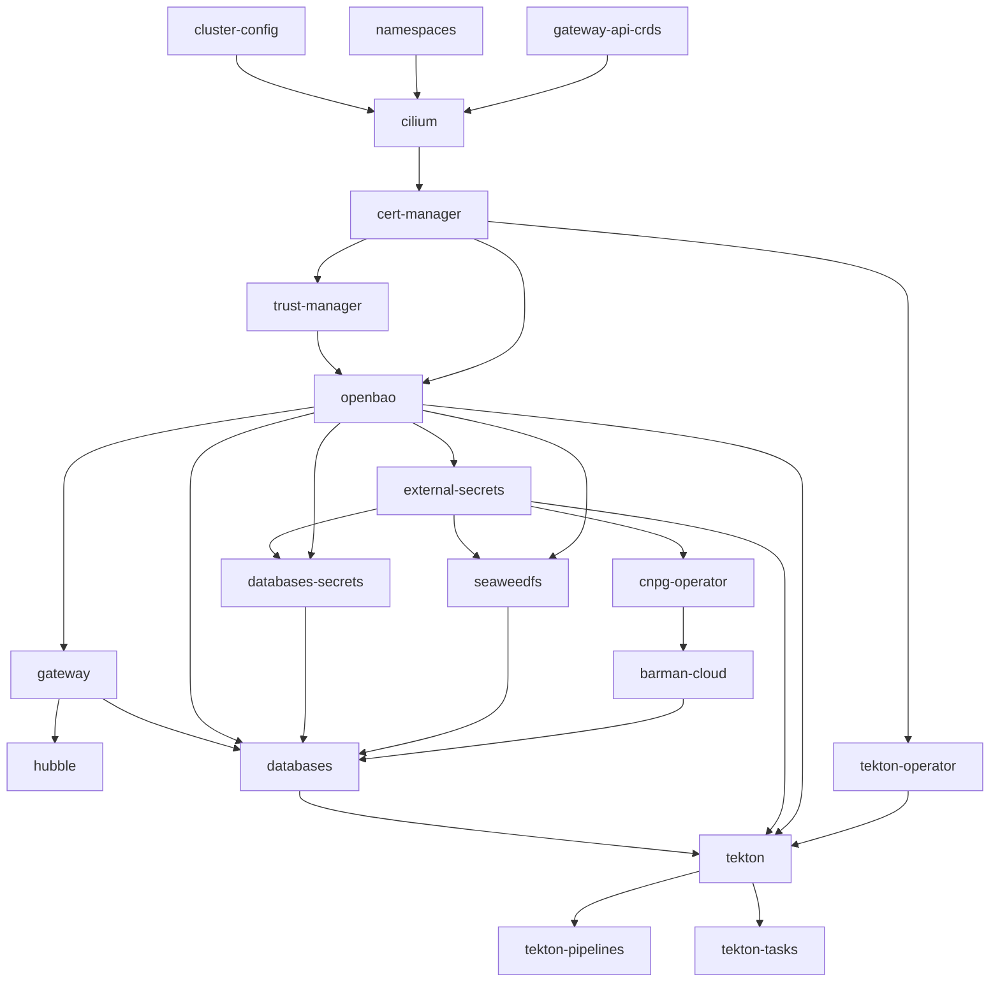

# Installation

This guide installs and configures a local single-node Kubernetes cluster tailored for data science workloads. [Verification](VERIFICATION.md) checks the result once Flux has reconciled it.

The process uses Ansible to provision k3s, Cilium eBPF networking, Flux GitOps controllers, in-cluster OpenBao secrets management, and OpenTofu infrastructure configurations. Once Ansible finishes, Flux takes over GitOps management of the cluster.

Once host-side prerequisites are met, running `just bootstrap` orchestrates the entire cluster lifecycle and reconciles all platform services declaratively.

## Table of Contents

* [Requirements](#requirements)
  * [Host Tooling](#host-tooling)
  * [GitHub Authentication](#github-authentication)
  * [Host Firewall Configuration](#host-firewall-configuration)
  * [Clean Host State (if reinstalling)](#clean-host-state-if-reinstalling)
  * [Data Migration (if restoring an existing database)](#data-migration-if-restoring-an-existing-database)
* [Cluster Bootstrap](#cluster-bootstrap)
  * [Step 1: Clone Repository](#step-1-clone-repository)
  * [Step 2: Execute Ansible Bootstrap](#step-2-execute-ansible-bootstrap)
  * [Step 3: Secure OpenBao Credentials & Unseal Keys](#step-3-secure-openbao-credentials--unseal-keys)
* [Flux Dependency Graph](#flux-dependency-graph)

---

## Requirements

### Host Tooling

#### Flux CLI

Install the version the committed `clusters/local/flux-system/gotk-components.yaml` pins:

```bash
curl -s https://fluxcd.io/install.sh | sudo FLUX_VERSION=2.9.6 bash
flux version --client
```

#### fzf

Used by `just fuzzypods`.

* **Ubuntu / Debian**:

  ```bash
  sudo apt update && sudo apt install -y fzf
  ```

* **Fedora / RHEL / Red Hat**:

  ```bash
  sudo dnf install -y fzf
  ```

#### GitHub CLI (`gh`)

* **Ubuntu / Debian**:

  ```bash
  curl -fsSL https://cli.github.com/packages/githubcli-archive-keyring.gpg | sudo tee /usr/share/keyrings/githubcli-archive-keyring.gpg > /dev/null
  echo "deb [arch=$(dpkg --print-architecture) signed-by=/usr/share/keyrings/githubcli-archive-keyring.gpg] https://cli.github.com/packages stable main" | sudo tee /etc/apt/sources.list.d/github-cli.list > /dev/null
  sudo apt update && sudo apt install -y gh
  ```

* **Fedora / RHEL / Red Hat**:

  ```bash
  sudo dnf install -y 'dnf-command(config-manager)' 2>/dev/null || sudo dnf install -y dnf-plugins-core
  sudo dnf config-manager --add-repo https://cli.github.com/packages/rpm/gh-cli.repo
  sudo dnf install -y gh
  ```

#### GnuPG and OpenSSL

`gpg` encrypts the OpenBao unseal keyfile during `just bootstrap` and decrypts it on every `just start`. `just preflight` checks that both are installed.

* **Ubuntu / Debian**:

  ```bash
  sudo apt update && sudo apt install -y gnupg openssl
  ```

* **Fedora / RHEL / Red Hat**:

  ```bash
  sudo dnf install -y gnupg2 openssl
  ```

#### Helm

```bash
curl -fsSL -o get_helm.sh https://raw.githubusercontent.com/helm/helm/main/scripts/get-helm-4
chmod +x get_helm.sh
./get_helm.sh
rm get_helm.sh
helm version
```

#### Hubble CLI

```bash
HUBBLE_VERSION=$(curl -s https://raw.githubusercontent.com/cilium/hubble/main/stable.txt)
HUBBLE_ARCH=amd64
if [ "$(uname -m)" = "aarch64" ]; then HUBBLE_ARCH=arm64; fi
curl -L --fail --remote-name-all https://github.com/cilium/hubble/releases/download/$HUBBLE_VERSION/hubble-linux-${HUBBLE_ARCH}.tar.gz{,.sha256sum}
sha256sum --check hubble-linux-${HUBBLE_ARCH}.tar.gz.sha256sum
sudo tar xzvfC hubble-linux-${HUBBLE_ARCH}.tar.gz /usr/local/bin
rm hubble-linux-${HUBBLE_ARCH}.tar.gz{,.sha256sum}
hubble version
```

#### Just

* **Ubuntu / Debian**:

  ```bash
  sudo apt update && sudo apt install -y just
  ```

* **Fedora / RHEL / Red Hat**:

  ```bash
  sudo dnf install -y just
  ```

#### kubectl

Install the release `KUBECTL_VERSION` pins in `infrastructure/cluster-config/versions.yaml`, which matches `K3S_VERSION` without the `+k3s` suffix:

```bash
KUBECTL_VERSION=v1.37.1
KUBECTL_ARCH=amd64
if [ "$(uname -m)" = "aarch64" ]; then KUBECTL_ARCH=arm64; fi
curl -LO "https://dl.k8s.io/release/${KUBECTL_VERSION}/bin/linux/${KUBECTL_ARCH}/kubectl"
sudo install -m 0755 kubectl /usr/local/bin/kubectl
rm kubectl
kubectl version --client
```

#### kubectl cnpg Plugin

Install the release matching the CNPG operator, which is the `appVersion` of the chart pinned by `CNPG_VERSION` (`helm show chart cloudnative-pg --repo https://cloudnative-pg.github.io/charts --version <CNPG_VERSION>`). `preflight.sh` checks the match.

```bash
CNPG_PLUGIN_VERSION=1.30.1
CNPG_ARCH=x86_64
if [ "$(uname -m)" = "aarch64" ]; then CNPG_ARCH=arm64; fi
CNPG_URL=https://github.com/cloudnative-pg/cloudnative-pg/releases/download/v${CNPG_PLUGIN_VERSION}/kubectl-cnpg_${CNPG_PLUGIN_VERSION}_linux_${CNPG_ARCH}
```

* **Ubuntu / Debian**:

  ```bash
  curl -LO "${CNPG_URL}.deb"
  sudo apt install -y "./kubectl-cnpg_${CNPG_PLUGIN_VERSION}_linux_${CNPG_ARCH}.deb"
  rm "kubectl-cnpg_${CNPG_PLUGIN_VERSION}_linux_${CNPG_ARCH}.deb"
  ```

* **Fedora / RHEL / Red Hat**:

  ```bash
  sudo dnf install -y "${CNPG_URL}.rpm"
  ```

#### OpenTofu

```bash
curl --proto '=https' --tlsv1.2 -fsSL https://get.opentofu.org/install-opentofu.sh -o install-opentofu.sh
chmod +x install-opentofu.sh
sudo ./install-opentofu.sh --install-method standalone --opentofu-version 1.13.1
rm install-opentofu.sh
tofu version
```

#### uv

`just bootstrap` runs Ansible through `uv run`, which builds `.venv` from `uv.lock` on first use, Python included.

```bash
curl -LsSf https://astral.sh/uv/install.sh | sh
uv --version
```

### GitHub Authentication

The cluster requires read-only access to this repository to synchronize manifests. You can authenticate using either a **GitHub App** (Recommended) or your personal **GitHub CLI** token.

**Option 1: GitHub App (Recommended)**
For secure, automated rotation of short-lived tokens, create a GitHub App in your account with **Read-only** access to `Contents`.

1. Generate a Private Key (`.pem`) for the app and save it locally.
2. Install the App on your repository.
3. Export the following environment variables before running the bootstrap:

   ```bash
   export GITHUB_APP_ID="<your-app-id>"
   export GITHUB_APP_INSTALLATION_ID="<your-installation-id>"
   export GITHUB_APP_PRIVATE_KEY_PATH="/path/to/your/private-key.pem"
   ```

**Option 2: GitHub CLI (Fallback)**
If you do not have a GitHub App configured, the bootstrap process will fall back to using your personal GitHub token.

1. Authenticate the CLI:

   ```bash
   gh auth login
   ```

2. Verify your status:

   ```bash
   gh auth status
   ```

### Host Firewall Configuration

* [ ] **Host firewall configured for Cilium** — you can configure your host firewall automatically using the `just setup-firewall` recipe, or apply the manual commands below for your distribution:

  ```bash
  just setup-firewall
  ```

* **Ubuntu / Debian (`ufw`)**:
  If `ufw` is active, allow Cilium's network interfaces and set default forward policy to `ACCEPT`:

  ```bash
  sudo ufw allow in on cilium_host
  sudo ufw allow in on cilium_net
  sudo ufw allow in on cilium_vxlan
  sudo ufw allow in on lxc+
  sudo sed -i 's/DEFAULT_FORWARD_POLICY="DROP"/DEFAULT_FORWARD_POLICY="ACCEPT"/' /etc/default/ufw
  sudo ufw reload
  ```

  Verify rule status:

  ```bash
  sudo ufw status verbose
  # Ensure DEFAULT_FORWARD_POLICY is accept (routed)
  # Ensure cilium_host, cilium_net, cilium_vxlan, and lxc+ are ALLOW IN
  ```

* **Fedora / RHEL (`firewalld`)**:
  `ufw` is not present on Fedora and RHEL; `firewalld` serves the same role. Allow forwarding, masquerading, DNS, and add Cilium interfaces/subnets to `trusted`:

  ```bash
  # 1. Base zone configuration (DNS, Gateway port, forward)
  # Masquerade is Cilium's job, not firewalld's.
  sudo firewall-cmd --zone=FedoraWorkstation --add-service=dns --permanent
  sudo firewall-cmd --zone=FedoraWorkstation --add-port=443/tcp --permanent
  sudo firewall-cmd --zone=FedoraWorkstation --add-forward --permanent
  sudo firewall-cmd --zone=trusted --add-service=dns --permanent
  sudo firewall-cmd --zone=trusted --add-source=10.42.0.0/16 --permanent
  sudo firewall-cmd --zone=trusted --add-source=10.43.0.0/16 --permanent
  sudo firewall-cmd --zone=trusted --add-interface=cilium_host --permanent
  sudo firewall-cmd --zone=trusted --add-interface=cilium_net --permanent
  sudo firewall-cmd --zone=trusted --add-interface=cilium_vxlan --permanent

  # 2. Container forwarding policies (priority -1: ANY <-> trusted, HOST -> ANY)
  sudo firewall-cmd --permanent --new-policy=k8s-forwarding-in 2>/dev/null || true
  sudo firewall-cmd --permanent --policy=k8s-forwarding-in --set-priority=-1
  sudo firewall-cmd --permanent --policy=k8s-forwarding-in --add-ingress-zone=ANY
  sudo firewall-cmd --permanent --policy=k8s-forwarding-in --add-egress-zone=trusted
  sudo firewall-cmd --permanent --policy=k8s-forwarding-in --set-target=ACCEPT

  sudo firewall-cmd --permanent --new-policy=k8s-forwarding-out 2>/dev/null || true
  sudo firewall-cmd --permanent --policy=k8s-forwarding-out --set-priority=-1
  sudo firewall-cmd --permanent --policy=k8s-forwarding-out --add-ingress-zone=trusted
  sudo firewall-cmd --permanent --policy=k8s-forwarding-out --add-egress-zone=ANY
  sudo firewall-cmd --permanent --policy=k8s-forwarding-out --set-target=ACCEPT

  sudo firewall-cmd --permanent --new-policy=k8s-forwarding-host 2>/dev/null || true
  sudo firewall-cmd --permanent --policy=k8s-forwarding-host --set-priority=-1
  sudo firewall-cmd --permanent --policy=k8s-forwarding-host --add-ingress-zone=HOST
  sudo firewall-cmd --permanent --policy=k8s-forwarding-host --add-egress-zone=ANY
  sudo firewall-cmd --permanent --policy=k8s-forwarding-host --set-target=ACCEPT

  sudo firewall-cmd --reload
  ```

  Verify rule and policy status:

  ```bash
  sudo firewall-cmd --list-all
  sudo firewall-cmd --zone=trusted --list-all
  sudo firewall-cmd --get-policies
  ```

* [ ] **Reserved IP range excluded from DHCP** — the cluster claims `192.0.2.240`–`192.0.2.250` on your LAN by default (`GATEWAY_IP` through `LAN_LB_POOL_STOP`, plus `COREDNS_LAN_IP`, in `infrastructure/cluster-config/networking.yaml`; `just preflight` checks them). Confirm your router's DHCP pool doesn't hand these out, and that nothing already answers on them:

  ```bash
  ping -c 2 -W 1 192.0.2.240
  ping -c 2 -W 1 192.0.2.242
  ```

### Clean Host State (if reinstalling)

If reinstalling over an existing k3s instance, tear it down first, then reboot before bootstrapping. Cilium's BPF programs stay attached in the kernel after `k3s-uninstall.sh`, and the `k3s` role refuses to install while that state is present:

```bash
just uninstall
sudo reboot
```

### Data Migration (if restoring an existing database)

Have a plain-SQL dump ready to restore once the CNPG cluster exists (see [Verify Database Deployment](VERIFICATION.md#verify-database-deployment)). Make it with `pg_dump --no-owner --no-privileges`, which leaves ownership and grants out of the file:

```bash
kubectl cnpg psql postgres-cluster -n databases --tty=false -- \
  -d data_science -c 'SET ROLE app_readwrite' -f - < /mnt/your/mount/path/data_science_backup.sql
```

`kubectl cnpg psql` runs `psql` in the primary and passes it the file on stdin. `SET ROLE app_readwrite` runs first in the same session, so every restored object belongs to `app_readwrite`.

## Cluster Bootstrap

### Step 1: Clone Repository

```bash
git clone https://github.com/DragonBishop/data_science_cluster.git
cd data_science_cluster
```

### Step 2: Execute Ansible Bootstrap

Installs the collections that the `dragonbishop.cluster` `galaxy.yml` depends on, then runs the full setup via the collection's playbook (`dragonbishop.cluster.data_cluster`): k3s, Cilium, Flux, OpenBao, and `terraform/openbao`. On a fresh clone, `uv run` first builds `.venv` from `uv.lock`. Idempotent and accepts optional flags (e.g. `--tags`, `--check`, `-v`). When prompted for `BECOME password:`, enter your local user's `sudo` password to allow root-level setup of `/etc/rancher/k3s/` and systemd services.

> [!TIP]
> **Just Recipe (automatically prompts for sudo):**
>
> ```bash
> just bootstrap
> ```

> [!NOTE]
> **Manual Shell Command:**
>
> ```bash
> uv run ansible-galaxy collection install --upgrade -p ansible ansible/ansible_collections/dragonbishop/cluster
> uv run ansible-playbook dragonbishop.cluster.data_cluster --ask-become-pass
> ```

### Step 3: Secure OpenBao Credentials & Unseal Keys

The bootstrap script prompts for a GPG passphrase and an OpenTofu state-encryption passphrase, then prints the in-cluster OpenBao unseal keys and root token.

> [!IMPORTANT]
> Store the generated unseal keys and root token in a secure password manager immediately. Data cannot be recovered if these keys are lost.

Future cluster starts (`just start` / `start-cluster.sh`) unseal OpenBao using the GPG-encrypted keyfile written during bootstrap to `.local/openbao/unseal-keys.gpg`, inside this repo and gitignored. `git clean -fdx` and `just uninstall` delete it, so keep a backup elsewhere. Note that the cache-TTL setting in `~/.gnupg/gpg-agent.conf` only governs `gpg-agent`'s in-memory cache; on desktop environments with a keyring-integrated pinentry (e.g. `pinentry-gnome3`), the passphrase can also be stored in the OS keyring. Add `no-allow-external-cache` to `~/.gnupg/gpg-agent.conf` to disable OS keyring caching.

## Flux Dependency Graph



* `cilium` requires `gateway-api-crds`, `namespaces` and `cluster-config`.
* `cert-manager` depends on `cilium`.
* `trust-manager` depends on `cert-manager`, which holds the `jetstack` HelmRepository and issues the trust-manager webhook's certificate.
* `openbao` depends on `cert-manager` (for `openbao-server-cert` TLS bootstrap) and `trust-manager` (for the Bundle CRD its CA Bundles use).
* `external-secrets` and `gateway` depend on `openbao` (for secrets sync and PKI).
* `cnpg-operator` depends on `external-secrets`, and `barman-cloud` depends on `cnpg-operator`.
* `hubble` depends on `gateway`.
* `databases-secrets` depends on `openbao` and `external-secrets` (whose webhook must admit its `ExternalSecret`s).
* `seaweedfs` depends on `namespaces`, `openbao` and `external-secrets` (for its own `seaweedfs-credentials`) and is Ready only after its install hook creates the `cnpg-backups` bucket.
* `databases` depends on `openbao`, `barman-cloud`, `seaweedfs`, `gateway`, and `databases-secrets`, so the PostGIS cluster starts with its backup bucket and its CA Secrets already in place.
* `tekton-operator` depends on `cert-manager`.
* `tekton` depends on `tekton-operator`, `openbao`, `external-secrets`, and `databases`. It holds Results' database login, whose ESO objects need OpenBao and ESO, and every Results login joins the `tekton_readwrite` role, which `databases` creates. The operator holds Results back until the login's Secret exists.
* `tekton-pipelines` and `tekton-tasks` depend on `tekton`, which installs the Pipeline and Task CRDs.

Once Flux reports every Kustomization Ready, continue with [Verification](VERIFICATION.md).
