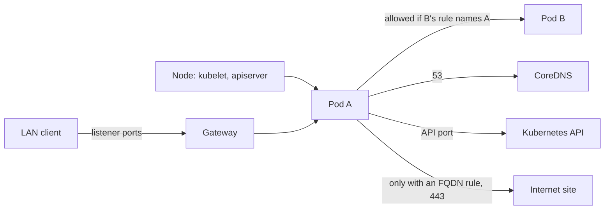
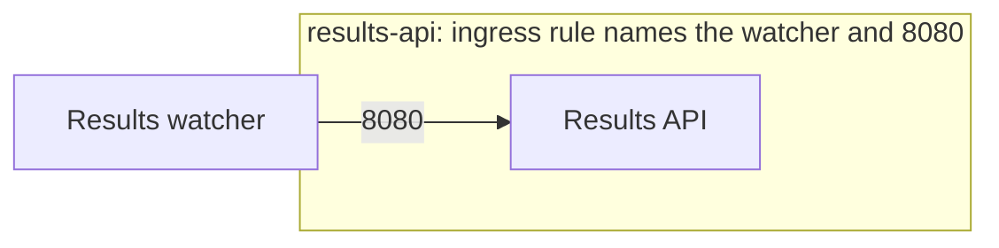
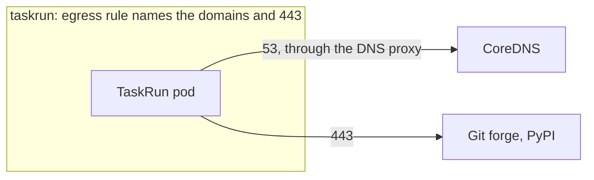
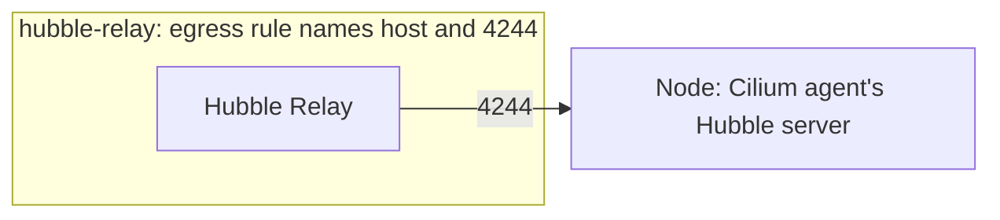
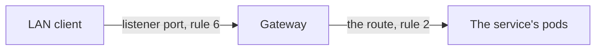

# Cluster Network Policy

## The Rules

**One policy for the cluster, one per namespace.** `cluster-default` is the one policy for the whole cluster. Every other rule belongs to one namespace, and lives in the policy file of the component that deploys into that namespace, beside its resources. No component writes policy into another component's namespace. A caller from another namespace, or from a module, gets its rule in the receiver's file, where it stays while the module is off.

The cluster baseline, `cluster-default` in [`infrastructure/cilium/cilium-clusterwide-networkpolicy.yaml`](../infrastructure/cilium/cilium-clusterwide-networkpolicy.yaml):

1. Every pod starts closed.
2. The node and the Gateway reach any pod.
3. Any pod reaches any other pod; the receiver decides.
4. Any pod reaches the Kubernetes API.
5. Any pod reaches CoreDNS.
6. The LAN and the node reach the Gateway.

Everything else is opened by the component that needs it:

* A pod accepts a call when its own policy names the caller and the port.
* A pod reaches an internet site when its own policy names the domain.
* A pod reaches a host port when its own policy names the port.
* A service is reached from the LAN through a Gateway route.

The rest of this page explains how these rules work and how to add to them.

## Host and LAN Access

The host firewall and Cilium have different jobs. The host firewall filters connections into the node. Cilium controls pod traffic and Gateway routing.

On Fedora/RHEL, the host firewall follows these rules:

1. The LAN interface uses a filtering zone, not an `ACCEPT` zone. Read `LAN_INTERFACE` from cluster-config; do not assume the default zone owns it.
2. Declare each host service explicitly. Keep named workstation services and individual port allowances; remove FedoraWorkstation's blanket TCP/UDP `1025-65535` allowances. Add a narrow exception before using a workstation application that previously relied on that range.
3. Keep DNS (53/TCP and UDP), Gateway HTTPS (443/TCP), and Gateway PostgreSQL (5432/TCP) available in the LAN zone. CoreDNS is the explicit exception to publishing services through Gateway.
4. Pods in the trusted Cilium zone may reach the host. `k8s-containers-to-host` accepts `trusted -> HOST`, never `ANY -> HOST`. The pod's Cilium egress policy still names the host ports it needs, including API 6443, kubelet 10250, and Hubble 4244.
5. Keep Cilium interfaces and pod CIDR trusted, existing forwarding policies intact, and masquerading owned by Cilium.

[`setup-firewall.sh`](../src/bash/setup-firewall.sh) applies these rules; [`preflight.sh`](../src/bash/preflight.sh) checks the LAN zone, port ranges, and policy directions. Neither changes k3s's listen addresses. The Ubuntu/Debian branch retains its existing UFW setup for Cilium; this Fedora correction does not establish equivalent UFW perimeter enforcement.

A local firewall configuration check does not prove LAN isolation. Cilium's eBPF service and NodePort paths can bypass ordinary host input filtering. Check service continuity and unwanted exposure from a separate LAN client as described in [Verification](VERIFICATION.md#host-firewall-network-checks). Adding a listener requires reviewing both the host firewall and the receiving Cilium policy.

## How Cilium Decides

Cilium treats each pod as open until a policy selects it. Once a policy with an `ingress` section selects a pod, that pod accepts the traffic the policy lists and drops the rest. An `egress` section does the same for outgoing traffic.

Policies add up. A pod selected by three policies accepts the traffic any of them allow. Nothing in this cluster subtracts traffic: there are no deny rules. Every rule you write opens one more path.

`cluster-default` selects every pod and has both sections. That one policy closes the whole cluster. Every other policy reopens a single path for a single workload.

## The Baseline

Each numbered comment in `cilium-clusterwide-networkpolicy.yaml` marks the rule below with the same number.

**1. Every pod starts closed.** The first entry selects every pod (`endpointSelector: {}`) and has both an `ingress` and an `egress` section. Rules 2 to 5 are the traffic it lets through.

**2. The node and the Gateway reach any pod.** The `host` entity is the node. It carries kubelet probes, and on k3s the apiserver's webhook calls also come from the host. The `ingress` entity is Cilium's Envoy, which carries Gateway traffic to the pods a route names. A pod that fails its probes or rejects its own webhook is broken, and every pod needs this rule.

**3. Any pod reaches any other pod; the receiver decides.** The receiving pod's policy decides whether the call lands. Ownership stays in one place: the pod that listens on a port declares who may use it.

**4. Any pod reaches the Kubernetes API.** Controllers and operators talk to the API on 6443. RBAC decides what they can do once connected.

**5. Any pod reaches CoreDNS.** Name lookups go to CoreDNS on 53. The `dns` rule sends them through Cilium's DNS proxy. The proxy is how Cilium learns which IP belongs to which domain, and `toFQDNs` rules depend on it.

**6. The LAN and the node reach the Gateway.** The second entry selects the Gateway's Envoy (`reserved:ingress`) and admits `LAN_CIDR` and the node's loopback. The Gateway's listeners and routes decide where that traffic goes next.



## Opening a Path

Each example below is a policy already in the cluster.

### A pod calls another pod

The Tekton Results watcher sends records to the Results API. The rule lives on the API, the receiving side:



[`infrastructure/tekton/tekton-networkpolicy.yaml`](../infrastructure/tekton/tekton-networkpolicy.yaml)

```yaml
spec:
  endpointSelector:
    matchLabels:
      app.kubernetes.io/name: tekton-results-api
  ingress:
    # Watcher sends PipelineRun and TaskRun records
    - fromEndpoints:
        - matchLabels:
            app.kubernetes.io/name: tekton-results-watcher
      toPorts:
        - ports:
            - port: "8080"
              protocol: TCP
```

In a namespaced policy, `fromEndpoints` matches pods in the policy's own namespace. To name a caller from another namespace, add `k8s:io.kubernetes.pod.namespace: <namespace>` to the rule's `matchLabels`, as `postgres-cluster` does for OpenBao.

Write the pod's listening port, not the Service port. Cilium translates the Service address before it checks policy. `kubectl get svc <name> -o yaml` shows the `targetPort`.

### A pod calls an internet site

TaskRun pods in `tekton-pipelines` clone from the Git forge and install from PyPI. The rule lives on the sender:



[`infrastructure/tekton-pipelines/tekton-pipelines-networkpolicy.yaml`](../infrastructure/tekton-pipelines/tekton-pipelines-networkpolicy.yaml)

```yaml
  egress:
    - toFQDNs:
        - matchName: "github.com"
        - matchPattern: "*.github.com"
        - matchName: "pypi.org"
        - matchName: "files.pythonhosted.org"
      toPorts:
        - ports:
            - port: "443"
              protocol: TCP
```

Name each host with `matchName`. Use `matchPattern` wildcards for vendor-owned domains, where one company owns every subdomain. Tenant domains such as `*.github.io` host many owners; list those by full name.

### A pod calls a host port

Hubble Relay reads the Cilium agent's Hubble server on the node:



[`infrastructure/cilium/kube-system-networkpolicy.yaml`](../infrastructure/cilium/kube-system-networkpolicy.yaml)

```yaml
  egress:
    - toEntities:
        - host
      toPorts:
        - ports:
            - port: "4244"
              protocol: TCP
```

### The LAN reaches a service

Add a Gateway route (`HTTPRoute` or `TCPRoute`) in the service's namespace. Baseline rule 6 already admits the LAN into the Gateway, and rule 2 admits the Gateway into pods.



### Adding an HTTPS service

Reuse the shared `https` listener on 443, its wildcard DNS, and its wildcard certificate. The configured domain is `cluster.internal`, so applications use names such as `example.cluster.internal` and the certificate covers `*.cluster.internal`. Adding a hostname under that wildcard needs no per-service edit to the Gateway, DNS, certificate, or host firewall.

## Conventions

* The cluster has one policy file, `infrastructure/cilium/cilium-clusterwide-networkpolicy.yaml`.
* Each namespace that needs more than the baseline has one policy file, `<component>-networkpolicy.yaml`, holding every policy object for that namespace. It sits in the directory of the Kustomization that deploys the namespace's resources.
* A namespace that needs nothing beyond the baseline has no policy file.
* A policy is named after the workload it selects, and holds that workload's incoming and outgoing rules.
* Each rule carries a one-line comment saying what the traffic is.
* Callers are named by namespace and `app.kubernetes.io/name`, or by the labels their chart sets.
* A port this repo sets comes from cluster-config as `${VAR}`. A port the upstream software fixes is a literal.
* A chart's own policy is fine when the chart builds it from its own port values. SeaweedFS does this.

## Finding a Missing Rule

```bash
hubble observe --verdict DROPPED -f
```

Each line shows the source, the destination and the port of a dropped connection. A drop between two pods means the receiver needs a rule naming that caller. A drop to `world` means the sender needs an FQDN rule. [Troubleshooting](TROUBLESHOOTING.md) covers `toPorts` rules that don't match.

## Bootstrap

Flux needs network access before it can deliver any policy, and so do the workloads Ansible installs before Flux. Ansible applies three files first, one per scope. The `cilium` role applies the cluster-wide file and `kube-system`'s file right after Cilium installs (`roles/cilium/tasks/policies.yml`). The `flux` role applies `flux-system`'s file (`roles/flux/tasks/sync.yml`). Flux takes ownership of them on its first reconcile.

## Policies

| Policy | File | Allows |
| --- | --- | --- |
| `cluster-default` | [`infrastructure/cilium/cilium-clusterwide-networkpolicy.yaml`](../infrastructure/cilium/cilium-clusterwide-networkpolicy.yaml) | Baseline rules 1 to 6 |
| `coredns` | [`infrastructure/cilium/kube-system-networkpolicy.yaml`](../infrastructure/cilium/kube-system-networkpolicy.yaml) | Every pod on 53; CoreDNS to upstream resolvers on 53 |
| `metrics-server` | [`infrastructure/cilium/kube-system-networkpolicy.yaml`](../infrastructure/cilium/kube-system-networkpolicy.yaml) | metrics-server to the kubelet on 10250 |
| `hubble-relay` | [`infrastructure/cilium/kube-system-networkpolicy.yaml`](../infrastructure/cilium/kube-system-networkpolicy.yaml) | Hubble Relay to the agent's Hubble server on 4244; Tekton runs to Relay on 4245 |
| `flux` | [`clusters/local/flux-system/flux-networkpolicy.yaml`](../clusters/local/flux-system/flux-networkpolicy.yaml) | Flux controllers to each other on 9090; Flux to its source hosts on 443 |
| `openbao` | [`infrastructure/openbao/openbao-networkpolicy.yaml`](../infrastructure/openbao/openbao-networkpolicy.yaml) | cert-manager, the OpenBao CSI Provider, the SPIRE server and `core-test` to OpenBao on 8200; OpenBao to the secrets-aws plugin's registry on 443 |
| `plugin-barman-cloud` | [`apps/barman-cloud/cnpg-system-networkpolicy.yaml`](../apps/barman-cloud/cnpg-system-networkpolicy.yaml) | The CNPG operator to the plugin on 9090 |
| `postgres-cluster` | [`apps/databases/databases-networkpolicy.yaml`](../apps/databases/databases-networkpolicy.yaml) | Instances to each other, OpenBao, Tekton Results and `core-test` on 5432; the CNPG operator on 8000 |
| SeaweedFS chart policies | [`apps/seaweedfs/seaweedfs-release.yaml`](../apps/seaweedfs/seaweedfs-release.yaml) (`networkPolicy`) | SeaweedFS components to each other; Postgres, OpenBao and `core-test` to S3 on `SEAWEEDFS_S3_PORT` |
| `remote-resolvers`, `results-api` | [`infrastructure/tekton/tekton-networkpolicy.yaml`](../infrastructure/tekton/tekton-networkpolicy.yaml) | The resolvers to their source hosts on 443; the Results watcher to the Results API on 8080 |
| `taskrun` | [`infrastructure/tekton-pipelines/tekton-pipelines-networkpolicy.yaml`](../infrastructure/tekton-pipelines/tekton-pipelines-networkpolicy.yaml) | TaskRuns to their source hosts on 443 |
